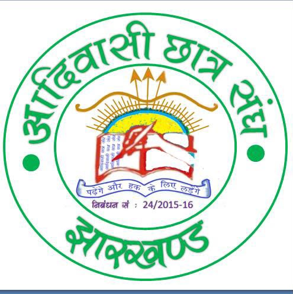

# आदिवासी छात्र संघ, झारखण्ड

**Adivasi Chhatra Sangh, Jharkhand** — Reg. No. 24/2015-16

*"पढ़ेंगे और हक के लिए लड़ेंगे"* — We will study, and we will fight for our rights.

Adivasi Chhatra Sangh is a registered student organisation working for tribal students and Adivasi communities across Jharkhand.

## What we stand for

- **Education (शिक्षा)** — affordable fees, scholarships, hostels and quality teaching for every tribal student.
- **Rights (अधिकार)** — defending the Fifth Schedule, PESA, CNT/SPT Acts and reservation.
- **Identity (पहचान)** — preserving Sarna faith, tribal languages, and festivals like Sarhul, Karma and Sohrai.
- **Unity (एकता)** — building democratic student units in colleges, hostels and districts.

This is the organisation's official website.
